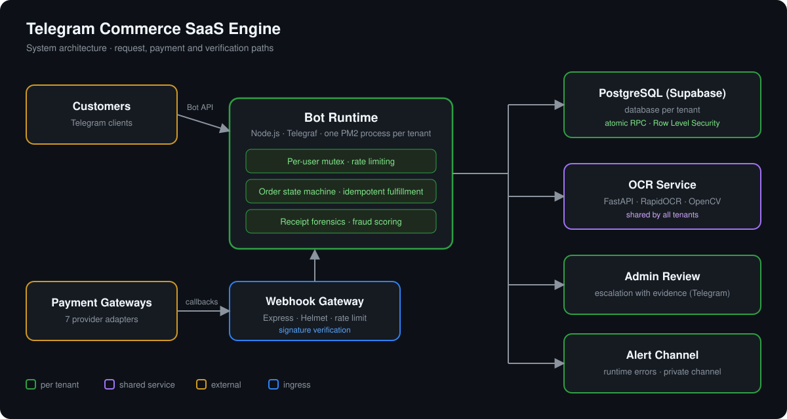
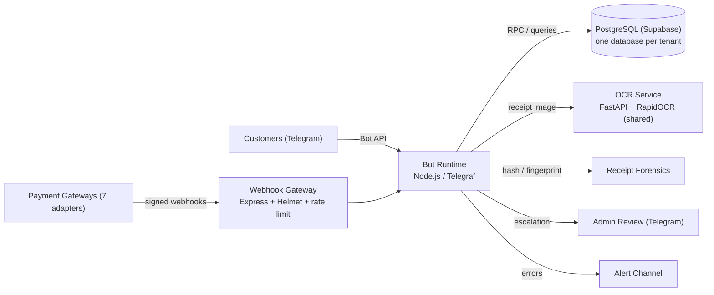
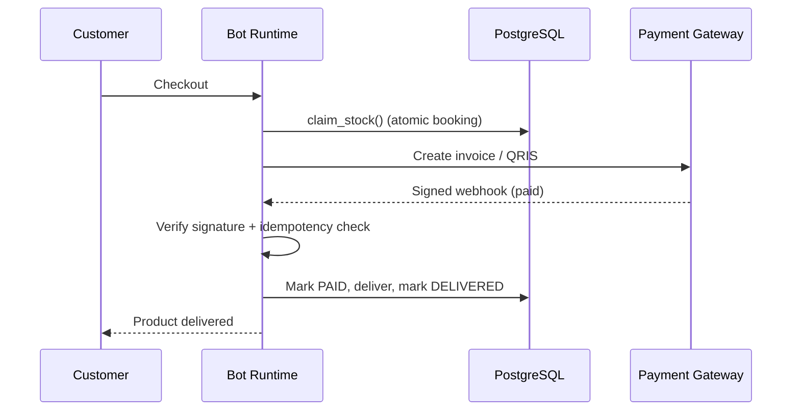
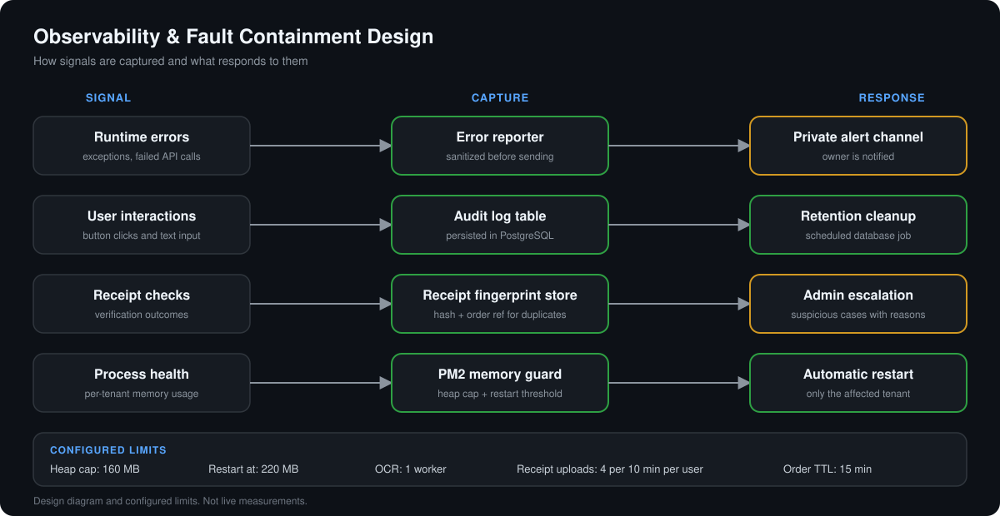

# telegram-commerce-saas-engine

Multi-tenant Telegram commerce engine: zero-trust payment webhooks, database-level inventory locking, and a self-hosted OCR forensics service for manual-transfer verification.


> **Notice:** The source code is **closed-source / proprietary**. This repository documents the system architecture, concurrency model, and security design only. Detection thresholds, keyword lists, credentials, and tenant data are intentionally omitted.

---

## 📌 System Overview

An automated storefront engine that runs inside Telegram. It connects customers, multiple Indonesian payment gateways, and a PostgreSQL backend, and delivers digital products automatically after payment is confirmed.

It is built as a **white-label SaaS**: every tenant (store) gets its own isolated bot process, database, and domain, while heavy workloads (OCR) are served by one shared microservice.

---

## 🏗 Architecture



<details>
<summary>Text version (Mermaid)</summary>



</details>

### Tech Stack

| Layer | Technology |
|---|---|
| Bot runtime | Node.js, Telegraf |
| HTTP / webhooks | Express, Helmet, express-rate-limit |
| Database | PostgreSQL via Supabase (RPC functions, Row Level Security) |
| OCR microservice | Python, FastAPI, RapidOCR (ONNX), OpenCV |
| Image hashing | Jimp (perceptual hash), SHA-256 |
| Scheduling | node-cron |
| Infrastructure | Linux VPS, PM2, Nginx or Cloudflare Tunnel |

---

## 🔒 Engineering Highlights

### 1. Multi-Tenant Isolation
- **Process-per-tenant:** each store runs as its own PM2 process with a capped V8 heap and automatic restart on memory overrun.
- **Database-per-tenant:** a failure or migration in one store cannot touch another.
- **Shared OCR microservice:** one inference service for all tenants, so the model is loaded once.

```bash
# Per-tenant process limits (conceptual)
NODE_OPTIONS="--max-old-space-size=160" pm2 start index.js \
    --name "bot-<tenant>" --max-memory-restart 220M
```

### 2. Zero-Trust Payment Ingestion
Seven payment gateways are integrated through an **adapter pattern** (one module per provider), so a new provider is a new adapter rather than a rewrite.

- Every callback to `/webhook/payment` is treated as hostile until verified.
- **Provider-specific signature verification** (HMAC-SHA256 and hash-based schemes), compared in constant time (`crypto.timingSafeEqual`).
- **Idempotent fulfillment:** an order that is already in a terminal state (`PAID` / `DELIVERED` / `CANCELLED`) is ignored, so repeated or replayed callbacks cannot double-deliver.
- Order lifecycle is a small state machine: `UNPAID → PAID → DELIVERED`, with `CANCELLED` for expiry.

### 3. Atomic Inventory (Database-Level Locking)
Stock claiming is not computed in Node.js. It runs inside PostgreSQL as a single RPC using `FOR UPDATE SKIP LOCKED`, so concurrent buyers never receive the same item.

```sql
-- Conceptual shape of the atomic claim
UPDATE stocks SET is_booked = true, booked_by_ref_id = :ref
WHERE id = (
  SELECT id FROM stocks
  WHERE product_code = :code AND is_sold = false AND is_booked = false
  ORDER BY created_at LIMIT 1
  FOR UPDATE SKIP LOCKED
);
```

Booked stock that is never paid is released automatically by database functions and a scheduled job, so abandoned checkouts do not lock inventory forever. Balance and voucher operations (increment / decrement) are also RPCs.

### 4. Concurrency Control & Abuse Resistance
- **Per-user mutex** blocks double-clicks and race conditions during checkout, with a fail-safe timeout so a crashed handler cannot deadlock a user.
- **Rate limiting** at two levels: Telegram update throttling per user, and HTTP limits on the webhook endpoint.
- **Bounded caches (LRU)** keep memory flat under long uptime.
- **Reputation controls:** risk scoring with automatic restriction of abusive accounts.

```js
// Conceptual: per-user lock with fail-safe auto-unlock
const lockUser = (userId) => {
  if (locked.has(userId)) return false;      // reject concurrent execution
  locked.set(userId, setTimeout(() => unlockUser(userId), FAILSAFE_MS));
  return true;
};
```

### 5. Receipt Verification Pipeline (Manual-Transfer Fallback)
When a customer pays by manual transfer, the receipt image goes through a layered pipeline before any human is involved:

1. **Input validation:** file type and size checks before processing.
2. **Self-hosted OCR:** text and layout extraction with RapidOCR, so receipt images stay on the operator's own infrastructure.
3. **Business-rule checks:** recipient, unique amount, and success-status validation.
4. **Duplicate defenses:** exact-match and perceptual hashing, plus a semantic fingerprint of transaction identifiers.
5. **Forensic signals:** metadata, layout, and confidence-based anomaly checks.
6. **Human-in-the-loop escalation:** uncertain or suspicious cases go to an admin with the evidence attached instead of being auto-approved.

The design principle: automation reduces risk and workload, but **a receipt is never treated as final proof of payment**. Webhook-confirmed gateway payments remain the authoritative path.

### 6. Data-Plane Hardening
All tables have Row Level Security enabled, and public roles are denied by default. Only the backend's service role can access data.

```sql
-- Conceptual: default-deny for public roles
ALTER TABLE <table> ENABLE ROW LEVEL SECURITY;
REVOKE ALL ON <table> FROM anon, authenticated;
GRANT  ALL ON <table> TO service_role;
```

### 7. Operations & Fleet Management
- **One-command tenant provisioning:** an interactive deploy script sets up the environment, process, reverse proxy / tunnel, and port registry.
- **Fleet-wide migrations:** a CLI applies SQL changes to every tenant database, guarded by a confirmation step.
- **Backup & restore:** multi-table JSON export with SHA-256 integrity checksums.
- **Scheduled jobs:** expired-order cancellation, stock release, data retention cleanup, and daily sales reports.
- **Error reporting:** runtime errors are pushed to a private Telegram alert channel; sensitive actions are written to an audit log.

---

## 🔁 Payment Flow



---

## 📊 Footprint

| Metric | Value |
|---|---|
| Core modules | ~8.4k lines (Node.js + Python) |
| Payment gateway adapters | 7 |
| Scheduled jobs | 7 |
| Tenancy model | Process + database per tenant |
| Per-tenant memory budget | 160 MB heap cap, restart at 220 MB |

---

## 🧭 Evolution

| | Earlier version | V2 |
|---|---|---|
| OCR | Third-party cloud OCR API | Self-hosted RapidOCR service |
| Tenancy | Single deployment | Provisioned per-tenant fleet |
| Database access | Application-side access | RLS default-deny + service role only |
| Fraud handling | Duplicate-receipt check | Layered receipt forensics with escalation |
| Inventory | Row locking | Booking + `SKIP LOCKED` claim + auto release |

## 🛠 Engineering Roadmap
- Split the large entrypoint into command, route, and job modules.
- Add a job queue in front of the OCR service for traffic bursts.

---

## 📈 Observability & Fault Containment



*Design diagram and configured limits, not live measurements.*

- **Error reporting:** runtime errors are sanitized and pushed to a private alert channel.
- **Audit trail:** privileged actions are persisted in PostgreSQL, with scheduled retention cleanup.
- **Receipt decision trail:** every verification outcome is logged, and suspicious cases are escalated with reasons.
- **Fault containment:** a memory guard restarts only the affected tenant process, so one store's failure does not take down the others.

---

## 👤 Author

Built and maintained by [@hugogustaaf](https://github.com/hugogustaaf).
For architecture questions or collaboration, open an issue or reach out through GitHub.
