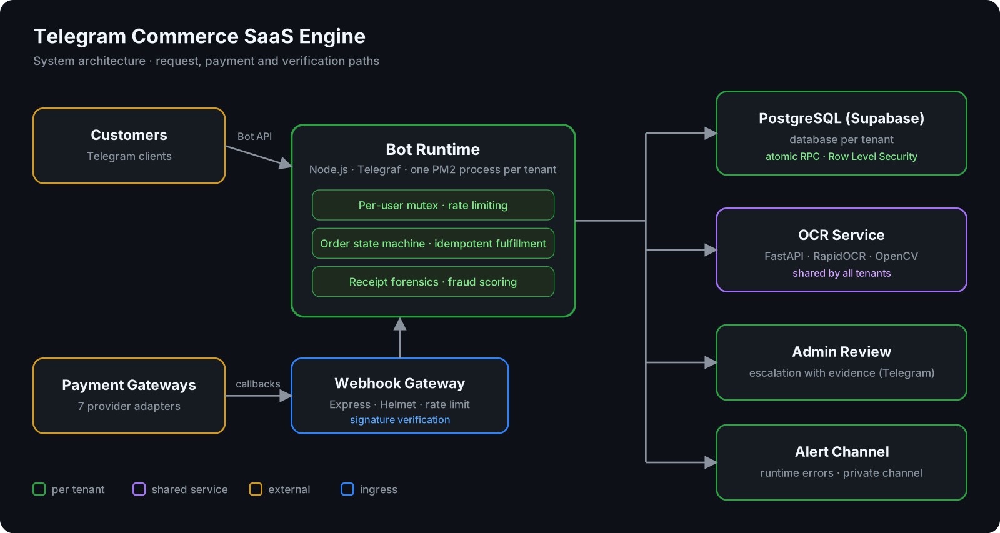
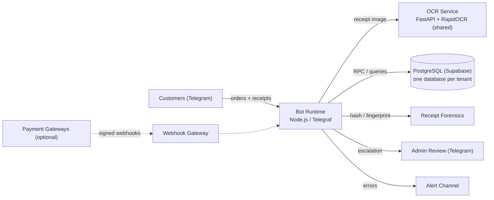
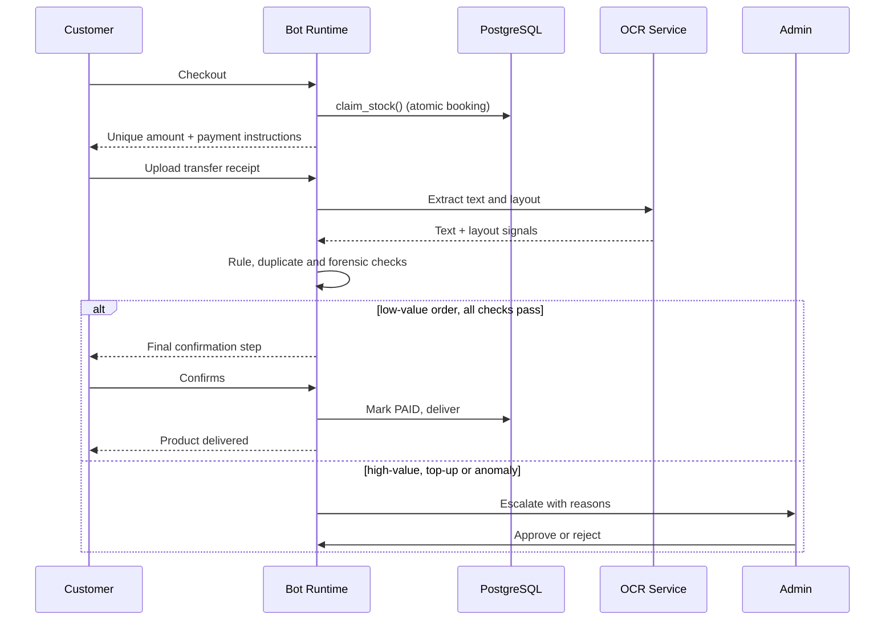
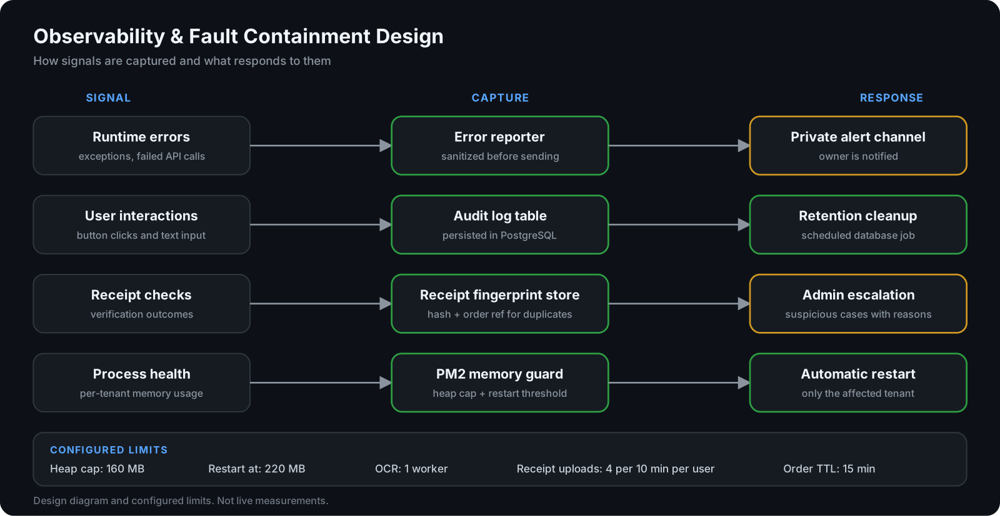

# telegram-commerce-saas-engine

Multi-tenant Telegram store engine that verifies manual-transfer receipts with a self-hosted OCR pipeline, claims stock atomically in PostgreSQL, and hands doubtful cases to a human.


> **Notice:** The source code is **closed-source / proprietary**. This repository documents the architecture, concurrency model, and security design only. Detection thresholds, keyword lists, credentials, and tenant data are intentionally left out.

---

## 📌 Overview

An automated storefront that runs inside Telegram and delivers digital products once a payment is verified.

The main design choice: **money goes straight to the store's own account, with no payment gateway in between.** Because nothing external announces "paid", the bot has to verify the customer's transfer receipt itself. That verification pipeline, built on a self-hosted OCR service, is the core of this project.

Payment gateways are still supported as an **optional** adapter layer for tenants who want them, but they are not on the main path.

It is built as a white-label SaaS: each tenant (store) gets an isolated bot process, database, and domain, while the OCR service is shared.

---

## 🏗 Architecture



<details>
<summary>Text version (Mermaid)</summary>



</details>

### Tech Stack

| Layer | Technology |
|---|---|
| Bot runtime | Node.js, Telegraf |
| HTTP / webhooks | Express, Helmet, express-rate-limit |
| Database | PostgreSQL via Supabase (RPC functions, Row Level Security) |
| OCR microservice | Python, FastAPI, RapidOCR (ONNX), OpenCV |
| Image hashing | Jimp (perceptual hash), SHA-256 |
| Scheduling | node-cron |
| Infrastructure | Linux VPS, PM2, Nginx or Cloudflare Tunnel |

---

## 🔒 Engineering Highlights

### 1. Receipt Verification Pipeline (main payment path)
Every order gets a unique payable amount. The customer pays by direct transfer and uploads the receipt, which then goes through several layers:

1. **Input validation:** a MIME-type whitelist for document uploads at the bot, plus size and pixel-count limits enforced inside the OCR service.
2. **Self-hosted OCR:** text and layout extraction with RapidOCR, so receipt images stay on the operator's own infrastructure.
3. **Business-rule checks:** recipient, unique amount, and success status must all match.
4. **Duplicate defenses:** exact-match and perceptual hashing, plus a semantic fingerprint of transaction identifiers.
5. **Forensic signals:** metadata, layout, and confidence-based anomaly checks.
6. **Decision, by risk:**
   - Low-value orders that pass every layer and a final confirmation step are fulfilled automatically.
   - High-value orders, balance top-ups, and any receipt with an anomaly always go to a human admin, with the reasons attached.

Design principle: a receipt is **evidence, not settlement**. Several independent checks have to agree before the bot acts on its own, and the more money is at stake, the more a human is involved. No automated check is a 100% guarantee, so the review path stays in the design.

### 2. Atomic Inventory (Database-Level Locking)
Stock claiming runs inside PostgreSQL as a single RPC using `FOR UPDATE SKIP LOCKED`, so concurrent buyers never receive the same item.

```sql
-- Conceptual shape of the atomic claim
UPDATE stocks SET is_booked = true, booked_by_ref_id = :ref
WHERE id = (
  SELECT id FROM stocks
  WHERE product_code = :code AND is_sold = false AND is_booked = false
  ORDER BY created_at LIMIT 1
  FOR UPDATE SKIP LOCKED
);
```

Booked stock that is never paid is released automatically by database functions and a scheduled job, so abandoned checkouts do not lock inventory. Balance and voucher operations are RPCs as well.

### 3. Concurrency Control & Abuse Resistance
- **Per-user mutex** blocks double-clicks and race conditions during checkout, with a fail-safe timeout so a crashed handler cannot deadlock a user.
- **Rate limiting** on Telegram updates and on receipt uploads, so nobody can flood the admin with review requests.
- **Bounded caches (LRU)** keep memory flat over long uptimes.
- **Risk scoring** with automatic restriction of abusive accounts.

```js
// Conceptual: per-user lock with fail-safe auto-unlock
const lockUser = (userId) => {
  if (locked.has(userId)) return false;      // reject concurrent execution
  locked.set(userId, setTimeout(() => unlockUser(userId), FAILSAFE_MS));
  return true;
};
```

### 4. Multi-Tenant Isolation
- **Process-per-tenant:** each store runs as its own PM2 process with a capped V8 heap and automatic restart on memory overrun.
- **Database-per-tenant:** a failure or migration in one store cannot touch another.
- **Shared OCR microservice:** one inference service for all tenants, so the model is loaded once.

```bash
# Per-tenant process limits (conceptual)
NODE_OPTIONS="--max-old-space-size=160" pm2 start index.js \
    --name "bot-<tenant>" --max-memory-restart 220M
```

### 5. Data-Plane Hardening
All tables have Row Level Security enabled and public roles are denied by default. Only the backend's service role can access data.

```sql
-- Conceptual: default-deny for public roles
ALTER TABLE <table> ENABLE ROW LEVEL SECURITY;
REVOKE ALL ON <table> FROM anon, authenticated;
GRANT  ALL ON <table> TO service_role;
```

### 6. Optional Payment Gateway Adapters
Seven provider adapters exist for tenants who prefer gateway-confirmed payments. They sit off the main path, and when enabled they follow zero-trust rules:

- Every callback to `/webhook/payment` is treated as hostile until verified.
- Provider-specific signature verification, compared in constant time (`crypto.timingSafeEqual`).
- Idempotent fulfillment: an order already in a terminal state (`PAID` / `DELIVERED` / `CANCELLED`) is ignored, so replayed callbacks cannot double-deliver.

### 7. Webhook Hardening & Auto-Heal
- Telegram updates are accepted only with a matching secret-token header, compared in constant time.
- A watchdog checks the webhook registration every 5 minutes and re-registers it if it drifted, notifying the operator.
- Startup retries use exponential backoff (capped at about 10 minutes) and respect Telegram's rate-limit hints, so a 429 does not crash-loop the process.
- A `/health` endpoint reports readiness (200 or 503), uptime, and memory.

### 8. Multi-Admin Review Without Collisions
When several admins and the owner see the same pending order, a per-order mutex stops two people from processing it at once. Once one decision is made, the review buttons and captions are synced across every admin chat.

### 9. Ledger-Based Analytics
Sales totals and best-seller rankings are computed by database functions over the transactions table (paid and delivered orders only, top-ups excluded). Old sold stock can be cleaned up after 90 days without changing any reported number.

### 10. Operations & Fleet Management
- **One-command tenant provisioning:** an interactive deploy script sets up the environment, process, reverse proxy or tunnel, and port registry.
- **Fleet rollout script:** updates code across tenants, patches missing configuration, audits for unsafe keys, restarts processes, and restarts the shared OCR service.
- **Fleet-wide SQL migrations:** a separate CLI applies the schema file to every tenant database, behind a confirmation prompt.
- **Backup & restore:** multi-table JSON export with SHA-256 integrity checksums.
- **Scheduled jobs:** expired-order cancellation, stock release, retention cleanup, and daily sales reports.

---

## 🔁 Order & Verification Flow



---

## 📊 Footprint

| Metric | Value |
|---|---|
| Codebase | ~10k lines (Node.js, Python, SQL, shell, dashboard) |
| Optional gateway adapters | 7 |
| Scheduled jobs | 7 |
| Tenancy model | Process + database per tenant |
| Per-tenant memory budget | 160 MB heap cap, restart at 220 MB |

---

## 🧭 Evolution from V1

V1 is documented in [`saas-infrastructure-core`](https://github.com/hugogustaaf/saas-infrastructure-core). V2 changes the center of gravity of the system.

| | V1 | V2 |
|---|---|---|
| Main payment path | Gateway webhooks, with OCR as a fallback | Receipt verification, with gateways as an optional adapter |
| OCR | Google Cloud Vision API | Self-hosted RapidOCR service (FastAPI), shared by all tenants |
| Receipt fraud defense | Reuse prevention via bank reference ID | Layered forensics with human-in-the-loop escalation |
| Channels | Telegram + WhatsApp | Telegram only, deeper feature set |
| Inventory | Row-level locking RPC | Booking + `SKIP LOCKED` claim + automatic release of unpaid stock |
| Tenancy | Multi-tenant | Provisioned fleet: process and database per tenant, with deploy and fleet-migration tooling |
| Gateway callback check | Direct string comparison | Constant-time comparison |
| Data plane | Not documented | Row Level Security, default-deny for public roles |
| Ingress | Nginx | Nginx or Cloudflare Tunnel |

## 🛠 Engineering Roadmap
- Split the large entrypoint into command, route, and job modules.
- Add a job queue in front of the OCR service for traffic bursts.

---

## 📈 Observability & Fault Containment



*Design diagram and configured limits, not live measurements.*

- **Error reporting:** runtime errors are sanitized and pushed to a private alert channel.
- **Interaction audit trail:** button clicks and text input are persisted in PostgreSQL, with scheduled retention cleanup.
- **Receipt fingerprint store:** receipt hashes and order references are kept for duplicate detection. The reasons behind an escalation are shown to the admin in the review message.
- **Fault containment:** a memory guard restarts only the affected tenant process, so one store's failure does not take down the others.

---

## 👤 Author

Built and maintained by [@hugogustaaf](https://github.com/hugogustaaf).
For architecture questions or collaboration, open an issue or reach out through GitHub.
